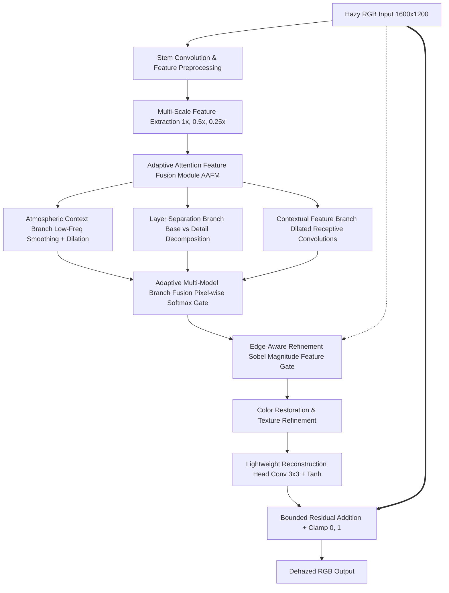

# Lightweight Edge-Aware Multi-Model Image Dehazing Framework for Real-Time Outdoor Vision Applications

**Academic Major Project**  
**Department:** Electronics and Communication Engineering | **Academic Year:** 2026–2027

---

## 1. Project Overview

This repository provides an end-to-end framework for lightweight, edge-aware outdoor image dehazing designed specifically for real-time edge computing and embedded robotics applications. 

The framework systematically investigates residual scale bounding, composite loss formulation ($L_1$, SSIM, and Sobel gradient loss), explicit edge conditioning, and multi-scale attention-guided feature fusion. 

### Key Highlights:
- **Primary Recommended Model:** **Stage 3.7 Experiment B** (`outputs/stage3_7_loss_l1_ssim/best_epoch_019.pt`).
- **Validation Quality:** **13.00 dB PSNR** | **0.4418 SSIM** | **0.187040 L1 error**.
- **Post-Hoc Held-Out Test Quality:** **14.72 dB PSNR** | **0.5441 SSIM** | **0.148768 L1 error**.
- **Efficiency:** Exactly **75,747 parameters** (933.6 KB FP32 checkpoint).
- **Throughput:** **182.14 ms / frame** (~5.5 FPS sustained warm latency at full $1600 \times 1200$; cold start ~347 ms) on an NVIDIA RTX 3050 Laptop GPU.

---

## 2. Environment Setup

The project uses Python 3.11 with CUDA-enabled PyTorch 2.5.1:

```powershell
# Activate the existing local virtual environment
.\.venv\Scripts\Activate.ps1
```

### Verified Dependency Stack:
- Python 3.11.5
- PyTorch 2.5.1 + CUDA 12.1
- torchvision 0.20.1
- NumPy 2.4.6
- OpenCV 5.0.0
- scikit-image 0.26.0
- Streamlit 1.66.0

---

## 3. Running Unit Tests

Run the full automated unit test suite (26 passing tests):

```powershell
python -m unittest discover tests
```

---

## 4. Generic Inference (CLI)

Use `scripts/infer.py` to run metadata-driven inference on single images or entire folders:

```powershell
# Single-image inference with the winning model
python scripts/infer.py --checkpoint outputs/stage3_7_loss_l1_ssim/best_epoch_019.pt --input data/NH-HAZE/53_hazy.png --output outputs/dehazed_sample.png --device cuda

# Batch folder inference
python scripts/infer.py --checkpoint outputs/stage3_7_loss_l1_ssim/best_epoch_019.pt --input data/NH-HAZE --output outputs/folder_predictions --device cuda
```

---

## 5. Streamlit Interactive Web Application

Launch the interactive web demo:

```powershell
streamlit run app.py
```

### Features:
1. **Model Selection:** Switch between Experiment B (Recommended), Multi-Model Variant v1, or Stage 3.6 Baseline.
2. **Hazy Image Upload:** Upload any standard image format (`PNG`, `JPEG`, `BMP`, `TIFF`).
3. **Optional Ground Truth Evaluation:** Upload a clean ground-truth reference image to compute real-time **PSNR** and **SSIM**.
4. **Side-by-Side Visualization:** Direct visual comparison with output size and inference latency metrics.
5. **Download:** One-click download of the dehazed PNG image.

---

## 6. Model Architecture & Pipeline



---

## 7. Model Zoo & Validation Standings

| Model / Experiment | Architecture | Loss Function | Parameters | Checkpoint Path | Val PSNR | Val SSIM | Val L1 |
|---|---|---|:---:|---|:---:|:---:|:---:|
| **Stage 3.6 Baseline** | 4 ResBlocks ($\pm0.2$) | $L_1$ | 75,747 | `outputs/residual_scale_continuation_0p2_rerun_1/best_epoch_020.pt` | 12.84 dB | 0.4268 | 0.192185 |
| **Stage 3.7 Exp B (Winner)** | 4 ResBlocks ($\pm0.2$) | $0.8 L_1 + 0.2 [1-\text{SSIM}]$ | **75,747** | `outputs/stage3_7_loss_l1_ssim/best_epoch_019.pt` | **13.00 dB** | **0.4418** | **0.187040** |
| **Stage 3.7 Exp C** | 4 ResBlocks ($\pm0.2$) | $0.8 L_1 + 0.15 \text{SSIM} + 0.05 \text{Sobel}$ | 75,747 | `outputs/stage3_7_loss_l1_ssim_sobel/best_epoch_019.pt` | 12.97 dB | 0.4371 | 0.188690 |
| **Stage 3.8 EC-Head** | 4-channel Sobel Head | $0.8 L_1 + 0.2 [1-\text{SSIM}]$ | 76,035 | `outputs/stage3_8_architectural_edge_guidance/best_epoch_020.pt` | 12.75 dB | 0.4227 | 0.191811 |
| **Multi-Model v1** | Multi-Scale + AAFM + 3 Branches | $0.8 L_1 + 0.2 [1-\text{SSIM}]$ | 114,753 | `outputs/multimodel_variant_v1_continuation_20261019/best_epoch_020.pt` | 11.64 dB | 0.4039 | 0.224439 |

---

## 8. Reports & Project Documentation

Comprehensive documentation is available in the `reports/` directory:
- [`reports/FINAL_PROJECT_REPORT.md`](reports/FINAL_PROJECT_REPORT.md) — Comprehensive academic major project report.
- [`reports/FINAL_RESULTS.md`](reports/FINAL_RESULTS.md) — Consolidated metrics and comparisons across all models.
- [`reports/DATASET_AUDIT.md`](reports/DATASET_AUDIT.md) — NH-HAZE and O-HAZE dataset verification.
- [`reports/TEST_BENCHMARK_PREFLIGHT.md`](reports/TEST_BENCHMARK_PREFLIGHT.md) — Post-hoc held-out benchmark preflight audit.
- [`reports/REMAINING_WORK_AUDIT.md`](reports/REMAINING_WORK_AUDIT.md) — Technical environment and task verification audit.
- [`reports/FINAL_HANDOVER.md`](reports/FINAL_HANDOVER.md) — Operational checklist and final handover.
