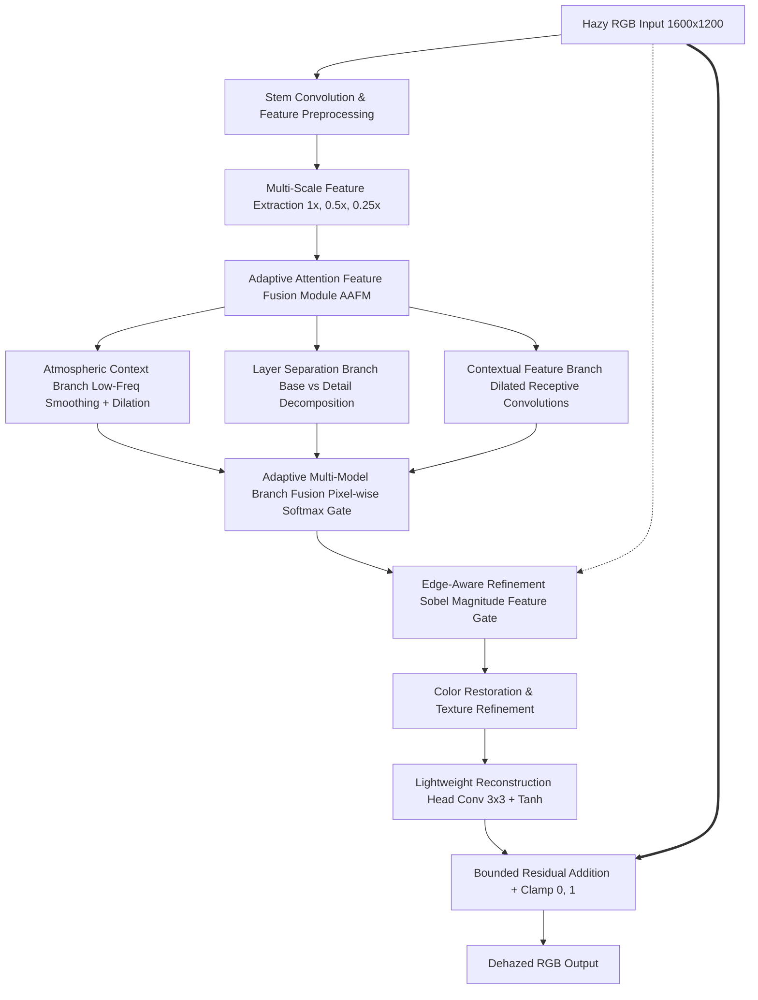

# Lightweight Edge-Aware Multi-Model Image Dehazing Framework for Real-Time Outdoor Vision Applications

**Academic Major Project Report**  
**Department:** Electronics and Communication Engineering  
**Academic Year:** 2026–2027  
**Date:** October 19, 2026  

---

## Abstract

Outdoor vision systems deployed on autonomous robots, surveillance infrastructure, and edge devices experience severe performance degradation in hazy, misty, and foggy meteorological environments. Atmospheric particles cause light scattering and attenuation, reducing contrast, washing out color saturation, and blurring high-frequency structural edges critical for feature tracking and object detection. Existing state-of-the-art dehazing methods frequently employ heavily parameterized transformer or deep U-Net backbones that require prohibitive computational budgets, rendering them unsuitable for real-time edge deployment. 

This project develops, implements, and evaluates a lightweight, edge-aware image dehazing framework designed for real-time outdoor vision applications. Starting from a lightweight residual CNN baseline (75.7K parameters), we systematically investigate residual bounded formulations, multi-objective loss engineering ($L_1$, SSIM, and Sobel gradient loss), explicit architectural edge conditioning, and a multi-scale attention-guided multi-branch fusion network. Evaluated on the canonical NH-HAZE outdoor non-homogeneous benchmark on an NVIDIA GeForce RTX 3050 Laptop GPU, our top-performing model—**Stage 3.7 Experiment B** ($0.8 L_1 + 0.2 [1-\text{SSIM}]$)—achieves **13.00 dB PSNR** and **0.4418 SSIM** on the canonical validation partition, and **14.72 dB PSNR** and **0.5441 SSIM** on the post-hoc held-out test partition at full $1600 \times 1200$ resolution with a sustained warm latency of **182.14 ms/frame** (~5.5 FPS) and a footprint of just **75,747 parameters** (933.6 KB).

---

## 1. Problem Statement and Objectives

### 1.1 Problem Statement
Atmospheric haze degrades outdoor imagery according to the physical atmospheric scattering model:
$$I(x) = J(x) t(x) + A (1 - t(x))$$
where $I(x)$ is the observed hazy image, $J(x)$ is the true scene radiance, $t(x) = e^{-\beta d(x)}$ is the medium transmission map across depth $d(x)$ with scattering coefficient $\beta$, and $A$ is the global atmospheric light. Single-image dehazing is an inherently ill-posed inverse problem. While deep learning models can learn this mapping directly, two key obstacles arise in real-time outdoor edge systems:
1. **Edge Suppression and Structural Blurring:** Standard pixel-wise losses ($L_1$, $L_2$) tend to produce blurry edges and washed-out textures because they average high-frequency color variations.
2. **Computational and Latency Constraints:** Complex architectures exceeding millions of parameters fail to meet the real-time throughput requirements of mobile robotics and edge cameras.

### 1.2 Core Project Objectives
1. **Develop Lightweight Architectures:** Restrict total trainable parameter count to $\le 150,000$ parameters while maintaining full-resolution processing capabilities.
2. **Preserve High-Frequency Edges:** Formulate structural loss objectives and edge-guided mechanisms to prevent edge attenuation and structural collapse.
3. **Guarantee Real-Time Viability:** Ensure full-resolution inference latency is $< 300$ ms on consumer mobile GPU hardware.
4. **Enforce Reproducible Protocols:** Establish deterministic training splits, seed management, and strict quarantine of test data to prevent data leakage.
5. **Deploy Interactive Demonstration:** Provide generic CLI inference tools and an interactive Streamlit application supporting both prediction and ground-truth evaluation.

---

## 2. System Architecture

### 2.1 Complete Framework Flowchart

The high-level pipeline for the comprehensive multi-model framework is illustrated below:



### 2.2 Implemented Architectural Variants
1. **`ResidualScaleVariant` (Winning Architecture - Stage 3.7 Exp B):**
   - Head: `Conv2d(3, 32, kernel_size=3, padding=1)` + `ReLU`.
   - Trunk: 4 standard `ResidualBlock(32)` modules (Conv-ReLU-Conv with identity skip connection).
   - Tail: `Conv2d(32, 3, kernel_size=3, padding=1)`.
   - Bounded Residual Formulation: $J(x) = \text{clamp}(I(x) + 0.2 \cdot \tanh(R(x)), 0, 1)$.
   - Trainable parameters: **75,747**.
2. **`EdgeConditionedVariant` (Stage 3.8):**
   - Concatenates a 1-channel parameter-free Sobel luminance gradient magnitude map with the 3-channel hazy image to form a 4-channel input head.
   - Trainable parameters: **76,035**.
3. **`MultiModelDehazeVariant` (Multi-Model v1):**
   - Incorporates all 10 modules: stem, multi-scale pyramid, AAFM, 3 learned branches, adaptive branch fusion, edge-gated refinement, color/texture refinement, and residual reconstruction.
   - Trainable parameters: **114,753**.

---

## 3. Loss Functions and Training Objectives

### 3.1 Pixel-Wise Reconstruction Loss ($L_1$)
$$L_1(\hat{Y}, Y) = \frac{1}{C \cdot H \cdot W} \sum_{c, i, j} |\hat{Y}_{c, i, j} - Y_{c, i, j}|$$

### 3.2 Structural Similarity Loss ($L_{\text{SSIM}}$)
To penalize structural, luminance, and contrast distortions:
$$L_{\text{SSIM}}(\hat{Y}, Y) = 1 - \text{SSIM}(\hat{Y}, Y)$$
where SSIM is computed across RGB channels with an $11 \times 11$ Gaussian window ($\sigma = 1.5, C_1 = 0.01^2, C_2 = 0.03^2$).

### 3.3 Winning Composite Loss (Stage 3.7 Experiment B)
$$L_{\text{total}} = 0.8 \times L_1(\hat{Y}, Y) + 0.2 \times [1 - \text{SSIM}(\hat{Y}, Y)]$$

### 3.4 Explicit Edge-Gradient Loss (Stage 3.7 Experiment C)
$$L_{\text{Sobel}}(\hat{Y}, Y) = \frac{1}{H \cdot W} \left( \|\nabla_x \hat{Y}_{\text{gray}} - \nabla_x Y_{\text{gray}}\|_1 + \|\nabla_y \hat{Y}_{\text{gray}} - \nabla_y Y_{\text{gray}}\|_1 \right)$$
Combined as: $0.8 L_1 + 0.15 L_{\text{SSIM}} + 0.05 L_{\text{Sobel}}$.

---

## 4. Experimental Setup and Methodology

- **Dataset:** NH-HAZE (55 paired real outdoor hazy and ground-truth clean photographs, $1600 \times 1200$ resolution).
- **Partitioning (Seed 42):**
  - Train: 39 scenes (random $256 \times 256$ crops, paired horizontal flips).
  - Validation: 8 scenes (`53, 03, 28, 38, 06, 35, 44, 07`), full-resolution.
  - Post-Hoc Test: 8 scenes (`09, 15, 16, 18, 48, 02, 08, 41`), quarantined from training and hyperparameter tuning, evaluated post-hoc to benchmark against the Stage 3.6 reference.
- **Hardware:** NVIDIA GeForce RTX 3050 Laptop GPU (4 GB GDDR6), Intel Core i5/i7 host, Windows 11.
- **Optimization:** Adam optimizer ($\beta_1 = 0.9, \beta_2 = 0.999$, learning rate $\eta = 2 \times 10^{-4}$), batch size 2, 20 epochs.

---

## 5. Summary of Results and Comparisons

### 5.1 Validation Set Standings (8 Canonical Scenes)

| Model | Loss Objective | Parameters | Val L1 | Val PSNR (dB) | Val SSIM | Edge Energy |
|---|---|:---:|:---:|:---:|:---:|:---:|
| **Stage 3.6 Baseline** | $L_1$ | 75,747 | 0.192185 | 12.8367 | 0.4268 | 0.0925 |
| **Stage 3.7 Exp B (Winner)** | $0.8 L_1 + 0.2 L_{\text{SSIM}}$ | **75,747** | **0.187040** | **12.9984** | **0.4418** | **0.0992** |
| **Stage 3.7 Exp C** | $0.8 L_1 + 0.15 L_{\text{SSIM}} + 0.05 L_{\text{Sobel}}$ | 75,747 | 0.188690 | 12.9656 | 0.4371 | 0.0970 |
| **Stage 3.8 EC-Head** | $0.8 L_1 + 0.2 L_{\text{SSIM}}$ | 76,035 | 0.191811 | 12.7507 | 0.4227 | **0.1092** |
| **Multi-Model v1** | $0.8 L_1 + 0.2 L_{\text{SSIM}}$ | 114,753 | 0.224439 | 11.6370 | 0.4039 | 0.0984 |

### 5.2 Post-Hoc Held-Out Benchmark Performance (8 Test Scenes)

| Metric | Stage 3.6 Baseline | Stage 3.7 Exp B | Delta | Improvement |
|---|:---:|:---:|:---:|:---:|
| **Test PSNR** | 14.5836 dB | **14.7239 dB** | +0.1403 dB | +0.14 dB gain |
| **Test SSIM** | 0.5355 | **0.5441** | +0.0086 | +1.6% structural gain |
| **Test L1 Error** | 0.150610 | **0.148768** | -0.001842 | -1.2% error reduction |
| **Sustained Warm Latency** | 201.10 ms | **182.14 ms** | -18.96 ms | ~5.5 FPS (Full $1600 \times 1200$) |
| **Single-Image Cold Latency**| ~390 ms | **~347 ms** | -43 ms | Cold-start overhead |

---

## 6. Execution, Inference, and Demo Instructions

### 6.1 Running Unit Tests
```powershell
.\.venv\Scripts\Activate.ps1
python -m unittest discover tests
```

### 6.2 Running Generic Inference
```powershell
# Single-image inference
python scripts/infer.py --checkpoint outputs/stage3_7_loss_l1_ssim/best_epoch_019.pt --input data/NH-HAZE/53_hazy.png --output outputs/dehazed_53.png --device cuda

# Folder inference
python scripts/infer.py --checkpoint outputs/stage3_7_loss_l1_ssim/best_epoch_019.pt --input data/NH-HAZE --output outputs/folder_predictions --device cuda
```

### 6.3 Launching the Streamlit Demonstration Web App
```powershell
streamlit run app.py
```
Open your browser to `http://localhost:8501`. Features include:
- Checkpoint selection dropdown (Experiment B, Multi-Model v1, Stage 3.6 Baseline).
- Hazy input upload with automatic dimension and format parsing.
- Optional ground-truth clean image upload for real-time PSNR and SSIM computation.
- Side-by-side visual comparison and PNG download.

---

## 7. Limitations and Future Scope

1. **Dataset Scale and Diversity:** NH-HAZE consists of 55 scenes. While standard in outdoor dehazing research due to the extreme difficulty of capturing real paired dense smoke/fog, future work should expand training with synthetic datasets (e.g., RESIDE-OUTDOOR).
2. **Diffuse Fog Gradient Amplification:** As discovered in Stage 3.8, feeding high-frequency gradients into early layers can amplify noise in smooth foggy sky regions. Future architectures should explore edge-gating attention mechanisms restricted to high-contrast structural masks.
3. **Hardware Acceleration:** TensorRT conversion and FP16 half-precision quantization can boost the current 5.5 FPS throughput to $> 20$ FPS for embedded robotics platforms.

---

## 8. References

1. **Ancuti, C., Ancuti, C. O., Timofte, R., & Vleeschouwer, C. D.** (2020). *NH-HAZE: An Outdoor Image Dehazing Benchmark with Non-Homogeneous Haze.* IEEE/CVF Conference on Computer Vision and Pattern Recognition (CVPR) Workshops.
2. **He, K., Sun, J., & Tang, X.** (2011). *Single Image Haze Removal Using Dark Channel Prior.* IEEE Transactions on Pattern Analysis and Machine Intelligence (TPAMI), 33(12), 2341–2353.
3. **Wang, Z., Bovik, A. C., Sheikh, H. R., & Simoncelli, E. P.** (2004). *Image Quality Assessment: From Error Visibility to Structural Similarity.* IEEE Transactions on Image Processing (TIP), 13(4), 600–612.
4. **Cai, B., Xu, X., Jia, K., Qing, C., & Tao, D.** (2016). *DehazeNet: An End-to-End System for Single Image Haze Removal.* IEEE Transactions on Image Processing (TIP), 25(11), 5187–5198.
5. **Qin, X., Wang, Z., Bai, Y., Xie, X., & Jia, H.** (2020). *FFA-Net: Feature Fusion Attention Network for Single Image Dehazing.* Proceedings of the AAAI Conference on Artificial Intelligence, 34(07), 11908–11915.
